  

# 🚀 Awesome Applicant Tracking System (ATS)

  <strong>🌟 Top Applicant Tracking Systems (ATS), Recruitment CRMs, and Open-Source Hiring Engines 🌟</strong>

  
  
  
  
  
  
  
  

---

## 📌 Curated Directory of SaaS Recruitment Platforms & Open-Source ATS Infrastructure

> **A comprehensive, SEO-optimized, and continuously maintained guide to Applicant Tracking Systems (ATS), Recruitment Management Systems (RMS), Candidate Relationship Management (CRM), automated resume screeners, and self-hosted talent acquisition software.**

Whether you are an enterprise HR executive seeking structured hiring pipelines, a high-growth tech startup looking for modern AI-native recruiting platforms, or an engineering team seeking self-hosted, vendor-independent, open-source ATS alternatives to Greenhouse, Lever, and Workday—this curated repository organizes tools by exact pricing, free tier limits, company valuation, and GitHub community stars.

📅 **Last updated:** October 2026

---

## 📑 Table of Contents

- [📊 Sector Overview & Market Dynamics](#-sector-overview--market-dynamics)
- [🏢 SaaS & Cloud-Hosted ATS Platforms](#-saas--cloud-hosted-ats-platforms)
- [💻 Open-Source GitHub Projects](#-open-source-github-projects)
- [🤝 How to Contribute](#-how-to-contribute)
- [💖 Support & Sponsorship](#-support--sponsorship)
- [📈 Star History](#-star-history)
- [⚠️ Disclaimer & Compliance](#️-disclaimer--compliance)

---

## 📊 Sector Overview & Market Dynamics

The global **Applicant Tracking System (ATS)** and recruiting software market is valued between **$2.6 billion and $3.3 billion**, with conservative projections forecasting expansion to **$4.8 billion – $8.5 billion by 2035** (growing at a Compound Annual Growth Rate of 7% to 11%). 

The industry displays a distinct **bimodal market concentration structure**:
- **Enterprise Tier (Concentrated & Oligopolistic):** Dominated by consolidated enterprise Human Capital Management (HCM) powerhouses and established talent acquisition suites (such as Workday, SAP SuccessFactors / SmartRecruiters, and Greenhouse) characterized by multi-year enterprise contracts, deep systems integration, and exceptionally high switching costs.
- **Mid-Market & SMB Tier (Moderately-to-Highly Fragmented):** Consists of hundreds of specialized platforms, visual Kanban tools, and emerging AI-native recruiting startups competing aggressively across developer hiring, high-volume seasonal staffing, and regional compliance requirements.

---

## 🏢 SaaS & Cloud-Hosted ATS Platforms

The table below lists industry-leading commercial applicant tracking systems sorted in descending order by **Company Size (Revenue / Valuation)**.

| 🏢 Platform | 💰 Company Size (Revenue / Valuation) | 🏷️ Pricing (Starting Tier) | ⏳ Free Tier / Trial Limits | ✨ Key Features & Best Suited For |
| :--- | :--- | :--- | :--- | :--- |
| **[Workday Recruiting](https://www.workday.com/)** | ~$10.1B Revenue / ~$50B Market Cap | ~$100–$180 PEPM (~$1,200+/employee/yr bundled in HCM, typical contracts $50,000–$100,000+/yr) | 0 days (No free tier or public trial; sales demonstration only) | Enterprise HCM integration, unified employee lifecycle, global talent compliance. Best for large enterprises already on Workday. |
| **[SmartRecruiters](https://www.smartrecruiters.com/)** | ~$1.5B Valuation (Acquired by SAP) / ~$100M+ ARR | $14,995/year (~$1,250/month) for SmartStart/Essential plan | 0 days (No permanent free tier; live guided sales trial upon request) | Enterprise recruitment platform, marketplace of 500+ integrated tools, AI screening. Best for mid-market to enterprise companies. |
| **[Greenhouse](https://www.greenhouse.com/)** | ~$820M+ Valuation / ~$220M ARR | $8,500/year (~$708/month) for Essential tier (<50 employees) | 0 days (No free tier or trial; sales consultation & custom sandbox demo only) | Structured hiring, interview kits, scorecard rubrics, deep DE&I reporting. Best for mid-market and scaling businesses. |
| **[Employ Inc. (Lever)](https://www.lever.co/)** | ~$250M–$500M Group Revenue | $6–$8 per employee/month (~$4,000–$7,000/year minimum contract) | 0 days (No free tier or self-serve trial; custom POC demo via sales) | Combines ATS with Candidate Relationship Management (CRM) and multi-channel drip sourcing. Best for high-growth tech companies. |
| **[Employ Inc. (Jobvite)](https://www.jobvite.com/)** | ~$250M–$500M Group Revenue | $4,800/year (~$400/month) for small business tier | 0 days (No free tier or public self-serve trial; private sandbox demo on evaluation) | Recruitment marketing, candidate relationship management, social job distribution, employee referral automation. Best for medium-to-large staffing & corporate teams. |
| **[Employ Inc. (JazzHR)](https://www.jazzhr.com/)** | ~$250M–$500M Group Revenue | $75/month (Hero plan, billed annually at $900/year; or $99/mo billed monthly) | 14-day free trial (Limited to test job postings, candidate evaluations, and core email features without automated resume sync) | Flat-rate pricing, syndication to free job boards, basic applicant tracking. Best for small businesses and startups making initial hires. |
| **[Workable](https://www.workable.com/)** | ~$50M–$70M ARR | $189/month (Starter tier for small teams, covers up to 2 active jobs) | 15-day free trial (Full feature access to recruiting tools, 2 active trial jobs, no credit card required) | AI candidate matching, auto-posting to 200+ job boards, mobile recruitment app. Best for SMBs wanting ready-to-run hiring software. |
| **[Teamtailor](https://www.teamtailor.com/)** | ~$41M ARR | $199/month (~$2,400/year entry tier, scaled by total employee count) | 14-day free trial (Full access to careers site builder, test candidate pipelines, unlimited teammate seats during trial) | Employer branding, drag-and-drop career site builder, unlimited hiring manager seats. Best for teams focused on employer branding and candidate experience. |
| **[Ashby](https://www.ashbyhq.com/)** | ~$39M ARR / ~$50M Series D Raised | $300/month ($3,600/year on Foundations plan for teams <100 employees) | 0 days (No self-serve free tier or public trial; interactive sandbox demo provided on qualified sales calls) | All-in-one recruiting, advanced pipeline analytics, automated interview scheduling, built-in CRM. Best for fast-growing companies and data-driven talent teams. |
| **[Breezy HR](https://breezy.hr/)** | ~$15M–$25M ARR | $157/month (Startup tier billed annually; or $189/mo billed monthly) | Free Forever plan (Bootstrap tier: 1 active job posting, 1 user seat, unlimited candidate resumes) + 14-day trial of paid tiers | Visual Kanban candidate pipeline, automated stage actions, video interviewing. Best for startups and small teams looking for a free starting tier. |

---

## 💻 Open-Source GitHub Projects

Curated self-hosted applicant tracking systems, open HRMS recruiting modules, and AI resume screening engines sorted in descending order by **GitHub_Stars**:

| 📦 Repository | ⭐ GitHub_Stars | 📜 License | 🛠️ Tech Stack | 📝 Description & Architectural Highlights |
| :--- | :---: | :--- | :--- | :--- |
| **[odoo/odoo](https://github.com/odoo/odoo)** |  | LGPL-3.0 | Python, JavaScript, PostgreSQL | **Odoo Recruitment Module** — Full-featured ERP recruitment suite with Kanban pipelines, drag-and-drop candidate stages, email integration, calendar interview scheduling, and instant candidate-to-employee onboarding. |
| **[frappe/erpnext](https://github.com/frappe/erpnext)** |  | GPL-3.0 | Python, JavaScript, MariaDB | **ERPNext Recruitment & HR** — Comprehensive open-source enterprise suite featuring job applicant management, staffing planning, interview evaluation records, and seamless integration with core HR operations. |
| **[frappe/hrms](https://github.com/frappe/hrms)** |  | GPL-3.0 | Python (Frappe), Vue.js, MariaDB | **Frappe HR** — Dedicated modern HRMS and recruitment tool tracking job openings, candidate resumes, interview feedback, and offer letters with deep payroll and lifecycle workflows. |
| **[horilla/horilla-hr](https://github.com/horilla/horilla-hr)** |  | LGPL-2.1 | Python (Django), PostgreSQL | **Horilla HR** — Rapidly growing open-source HRMS featuring a visual applicant pipeline, job requisition management, interview scheduling, and employee onboarding. |
| **[orangehrm/orangehrm](https://github.com/orangehrm/orangehrm)** |  | GPL-3.0 | PHP, MySQL | **OrangeHRM Community** — Established HR software with recruitment module covering candidate resume repositories, vacancy publishing, interview tracking, and hiring history. |
| **[opencats/OpenCATS](https://github.com/opencats/OpenCATS)** |  | MPL-2.0 | PHP, MariaDB | **OpenCATS** — The most established standalone open-source ATS and recruitment CRM, built specifically for staffing agencies and in-house hiring teams with resume parsing, job boards, and client management. |
| **[nueno-co/nueno](https://github.com/nueno-co/nueno)** |  | AGPL-3.0 | TypeScript, React, Node.js | **Nueno** — Open-source applicant tracking system offering a clean modern web UI for tracking applications, pipeline stages, and recruitment communications. |
| **[cross-solution/YAWIK](https://github.com/cross-solution/YAWIK)** |  | MIT | PHP, Laminas / Zend, MongoDB | **YAWIK** — Modular open-source ATS and job board application for managing candidate applications, publishing job vacancies, and organizing applicant evaluation teams. |
| **[chamals3n4/OpenATS](https://github.com/chamals3n4/OpenATS)** |  | MIT | PHP (Laravel), MySQL | **OpenATS** — Lightweight open-source recruitment and hiring management platform for candidate sourcing, application reviewing, and interview coordination. |
| **[Assystant/SpotAxis](https://github.com/Assystant/SpotAxis)** |  | MIT | Python (Django), PostgreSQL | **SpotAxis** — Open-source ATS with multi-organization support, customizable recruitment funnels per role, resume parsing, and career page generation. |
| **[Vytral/harly](https://github.com/Vytral/harly)** |  | MIT | TypeScript, React, PostgreSQL | **Harly** — Self-hosted modern ATS alternative to Greenhouse and Ashby built for technical teams, startups, and agencies. |
| **[imrohit4077/niyam](https://github.com/imrohit4077/niyam)** |  | MIT | Python (FastAPI), React 19, PostgreSQL | **Niyam** — AI-native applicant tracking system featuring candidate evaluation assistance, job management, audit logs, and API rate limiting. |

---

## 🤝 How to Contribute

Contributions are warmly encouraged! Help keep this ATS index up-to-date:

1. 🍴 **Fork** the repository.
2. 🌿 Create a new feature branch (`git checkout -b feature/add-new-ats`).
3. 📝 Add or edit entries in `README.md` following the tabular format:
   - For **SaaS**: Provide verified company size / revenue, exact starting tier pricing, and explicit free tier / trial limits.
   - For **Open-Source**: Include official repository link, Stars_Badge (`style=social&color=white`), license, and core tech stack.
4. 🚀 Commit your changes (`git commit -m 'Add <Platform> to ATS list'`).
5. 📬 Open a **Pull Request** detailing the additions or updates.

⭐ Don't forget to star the repository if you found it useful!

---

## 💖 Support & Sponsorship

If this curated guide has saved you time, helped you select an ATS, or inspired your open-source talent acquisition workflow, please consider supporting the ongoing maintenance of this project:

- 🌟 **Star this repository** on GitHub to increase visibility.
- 🍴 **Fork and share** it with fellow recruiters, engineering hiring managers, and HR leaders.
- ☕ **Buy me a coffee / Sponsor on GitHub:** Visit the [GitHub Sponsors Dashboard](https://github.com/sponsors/ishandutta2007) to back open-source documentation and maintenance.

Thank you to all supporters, stargazers, and contributors for making open hiring infrastructure accessible to everyone! 🙌

---

##  Star History

---

## ⚠️ Disclaimer & Compliance

- This repository is a **community-curated collection** provided for educational and benchmarking purposes. Inclusion does not imply official endorsement.
- **Privacy & Compliance (GDPR, CCPA, EEOC):** Applicant Tracking Systems store sensitive candidate PII (Personally Identifiable Information), resumes, contact details, and hiring feedback. Always ensure your deployment enforces role-based access control, data encryption in transit and at rest, retention schedules, and applicant consent protocols.
- **Suite Module vs. Dedicated ATS:** Tools like **OpenCATS**, **Nueno**, and **Niyam** are built solely for talent pipelines. Modules within ERPs like **Odoo Recruitment** or **ERPNext** provide seamless end-to-end employee transitions but involve deploying larger enterprise suites.
- **Self-Hosting Maintenance:** Operating self-hosted software requires active maintenance, database backups, and security patching.

---

  <strong>Made with ❤️ for recruiters, developers, and talent acquisition teams building open, data-driven hiring solutions.</strong>

